# Лаба 9. Git
## Оценка 3
1.git_status - команда показывает на какой ветке мы находимся. На ветке mybranch:

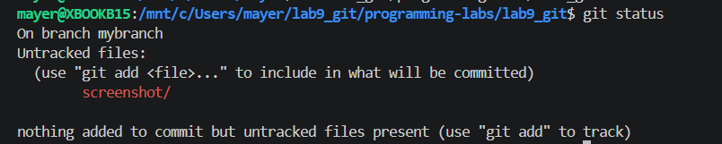

2.git_log - команда показывает журнал коммитов:

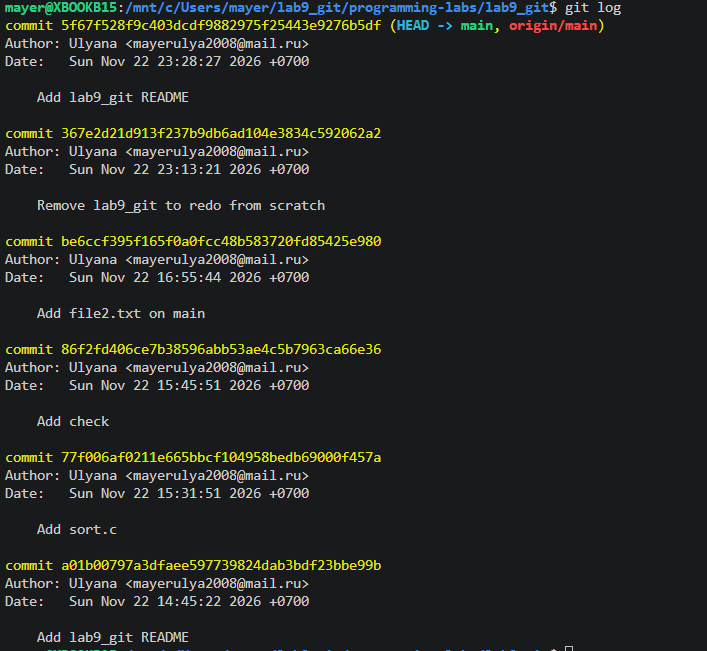

3.Создаем файл sort.c и вставляем туда данную функцию сортировки:

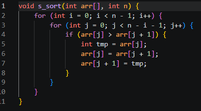

4.Как сейчас выглядит вывод git status:

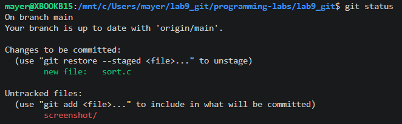

5.Добавим файл в область stage (add):

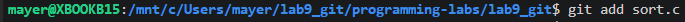

6.Как сейчас выглядит git status:

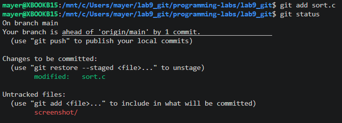

7.Закоммим файл в репозиторий(комнада git commit записывает изменения в историю репозитория):

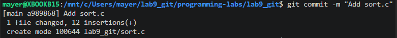

8.Как сейчас выглядит git status:

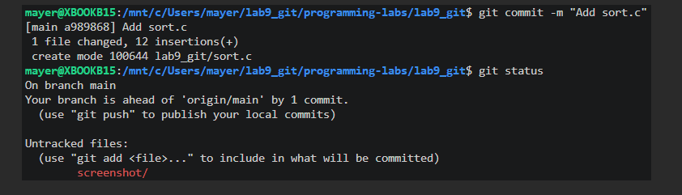

9.Добавим комментарий с любым текстом в этот же файл:

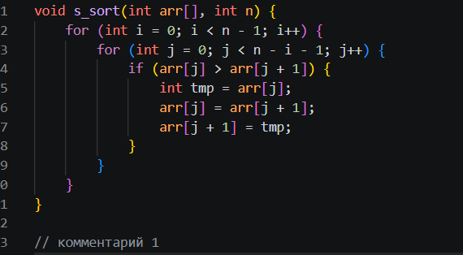

10.Как сейчас выглядит git status:

11.Добавьте (add) изменение файла:

12.Как сейчас выглядит git status:

13.Изменим файл еще раз:

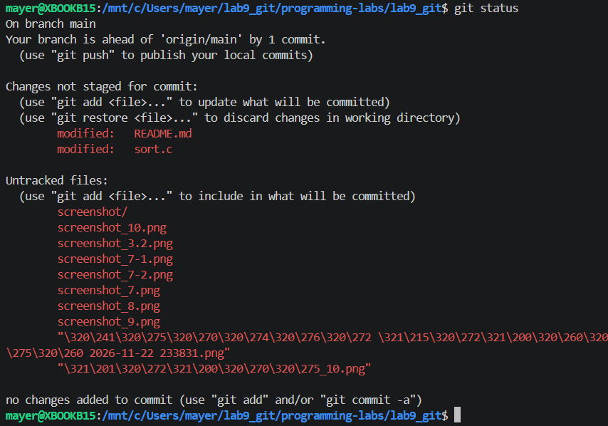

14.Сделать коммит:

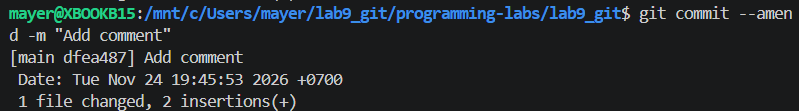

15.Как сейчас выглядит status.Журнал (log):

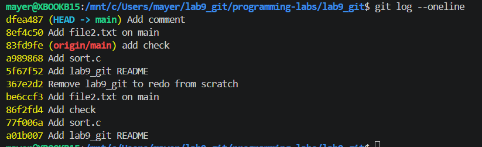

16.Добавим в stage и закоммитьте последнее изменение:

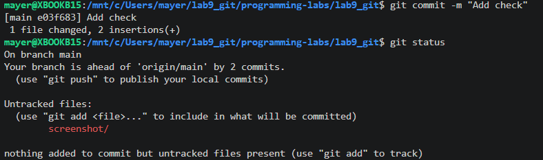

17.Запушили на удалённый репо с помощью команды git push.

Ветки:
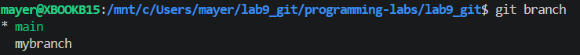

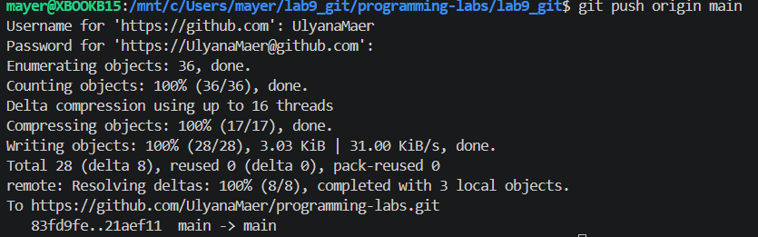
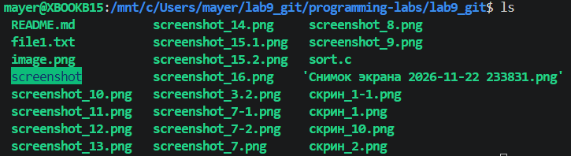
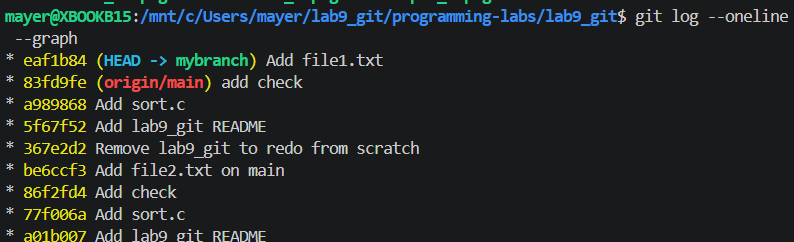
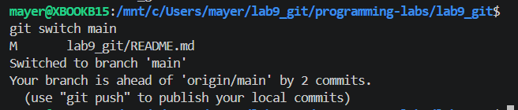
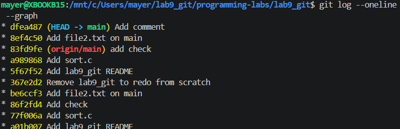
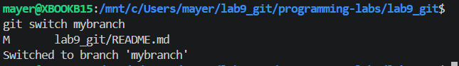

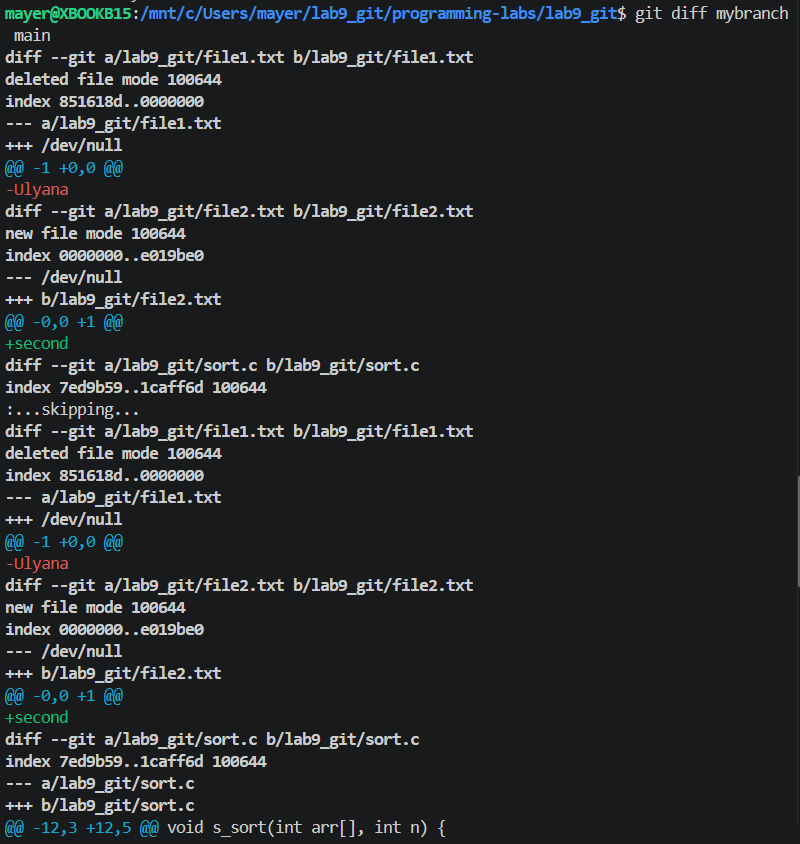

## Оценка 4
1.Убедимся, что находимся на ветке mybranch:

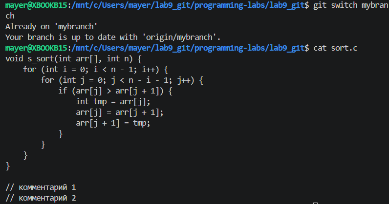

2.Перезапишим содержимое в sort.c  добавив функцию main():

3.git diff:

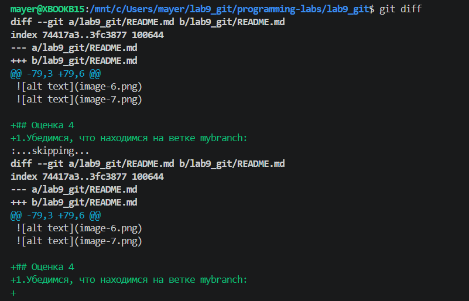

4.git diff --staged:

5.Добавим в staged файл sort.c:

6.git diff:

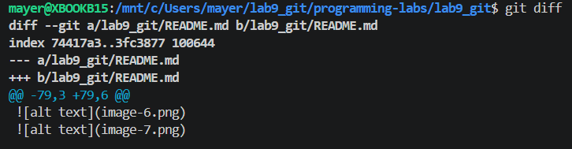

7.git diff --staged:

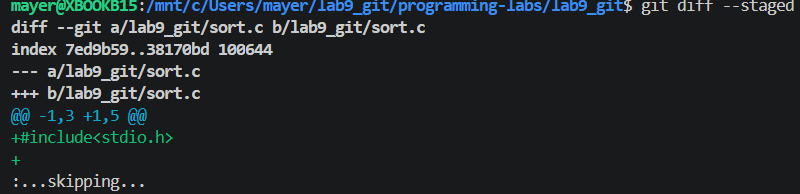

8: 
