# Лаба 9. Git
## Оценка 3
1.git_status - команда показывает на какой ветке мы находимся. На ветке mybranch:

2.git_log - команда показывает журнал коммитов:

3.Создаем файл sort.c и вставляем туда данную функцию сортировки:

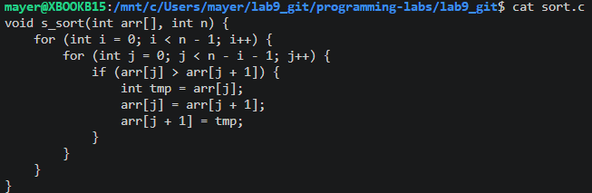

4.Как сейчас выглядит вывод git status:

5.Добавим файл в область stage (add):

6.Как сейчас выглядит git status:

7.Закоммим файл в репозиторий(комнада git commit записывает изменения в историю репозитория):

8.Как сейчас выглядит git status:

9.Добавим комментарий с любым текстом в этот же файл:

10.Как сейчас выглядит git status:

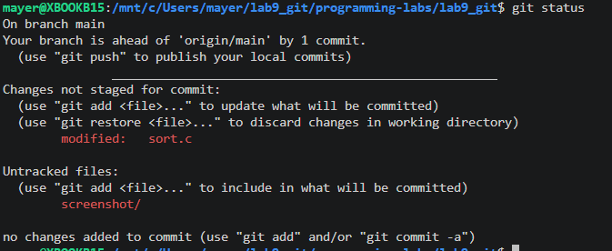

11.Добавьте (add) изменение файла:

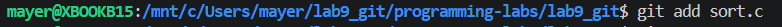

12.Как сейчас выглядит git status:

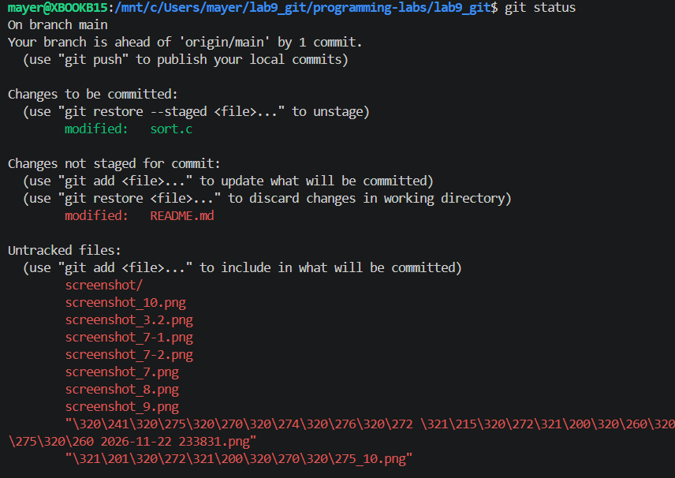

13.Изменим файл еще раз:

14.Сделать коммит:

15.Как сейчас выглядит status.Журнал (log):

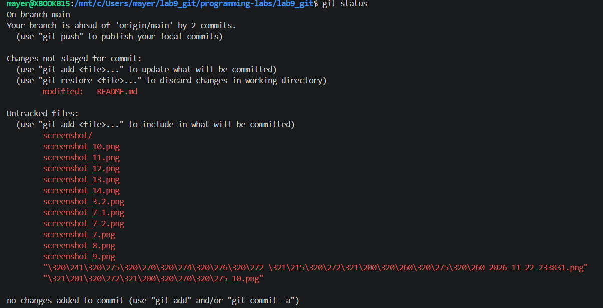

16.Добавим в stage и закоммитьте последнее изменение:

17.Запушили на удалённый репо с помощью команды git push.

Ветки:

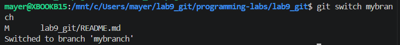
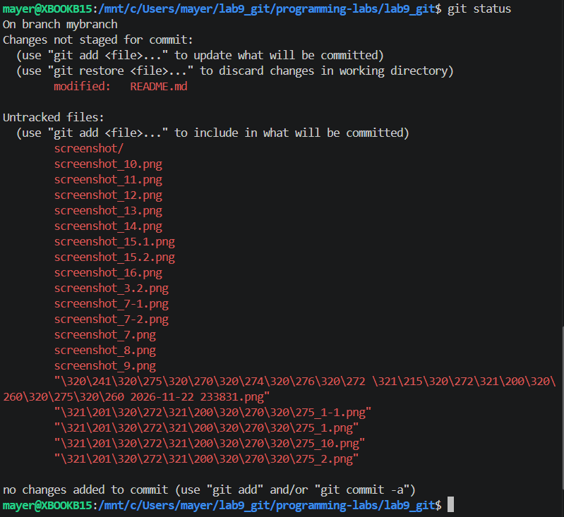
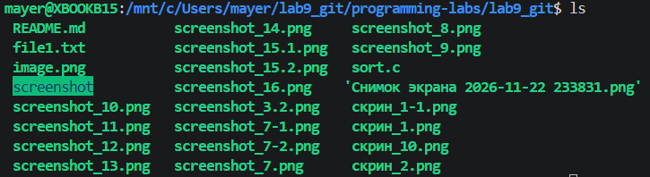

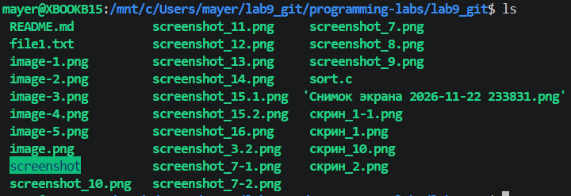

## Оценка 4
1.Убедимся, что находимся на ветке mybranch:

2.Перезапишим содержимое в sort.c  добавив функцию main():

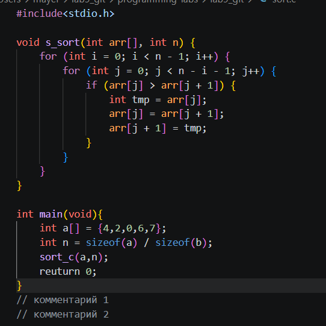

3.git diff:

4.git diff --staged:

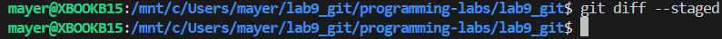

5.Добавим в staged файл sort.c:

6.git diff:

7.git diff --staged:

8: 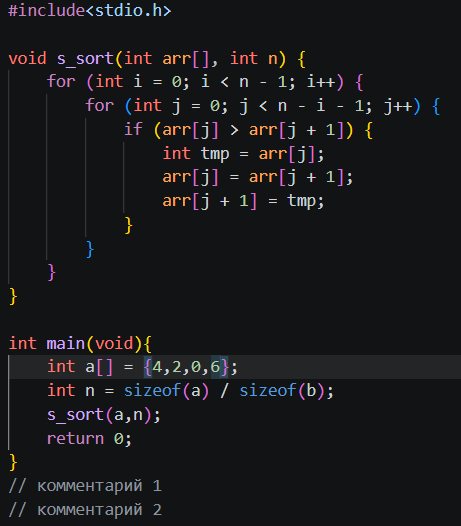

9.git diff:

10.git diff --staged:

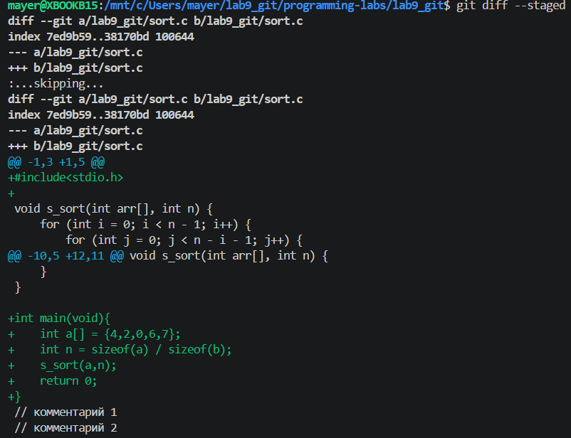

11.git diff сравнивает рабочую папку с индексом (stage), а
git diff --staged — индекс с последним коммитом.
Когда я удалила одно число из массива в файле, изменение оказалось только в рабочей папке: git diff показал именно удаление числа, а git diff --staged — только первую правку (добавление main и include).

12.Запустим git status:

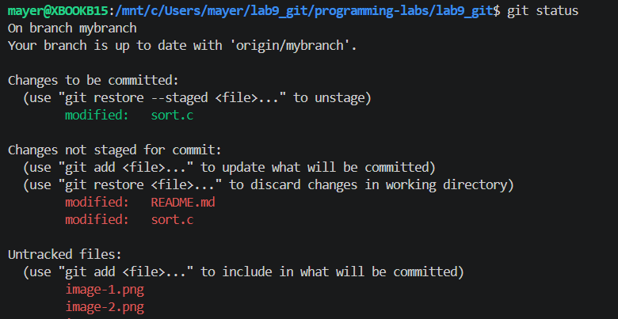

13.Запустим git restore --staged sort.c:

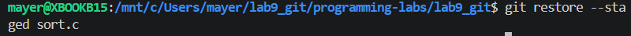

14.git status:

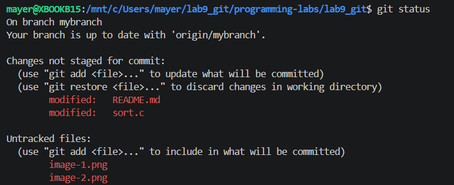

15.Проиндексируем изменение (add) и сделаем коммит:

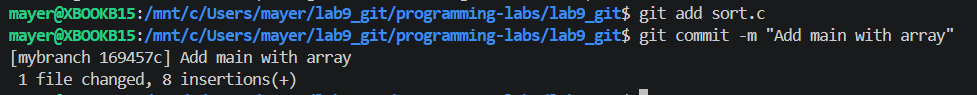

16.git log:

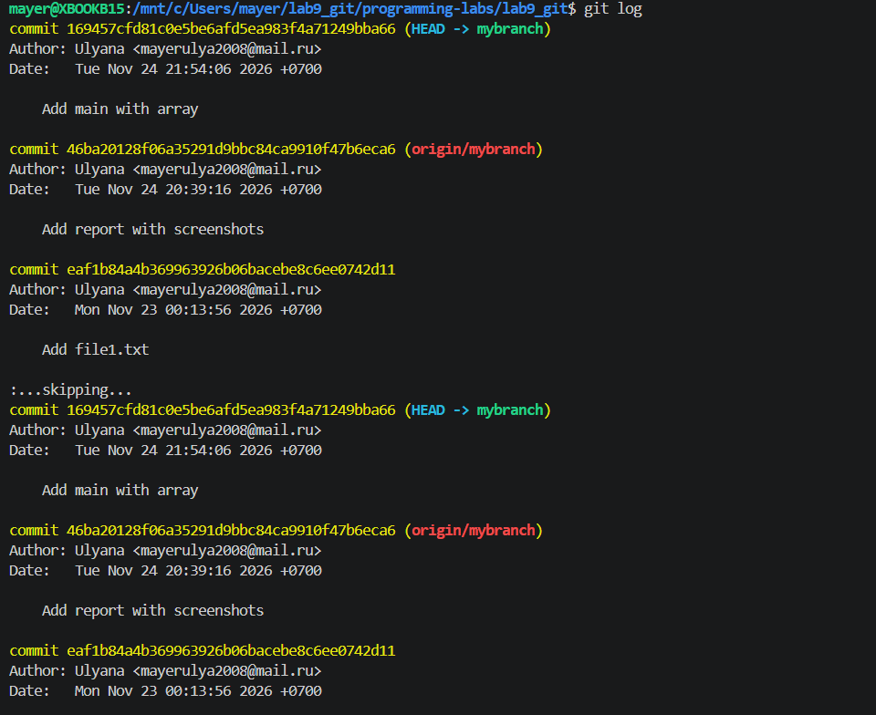
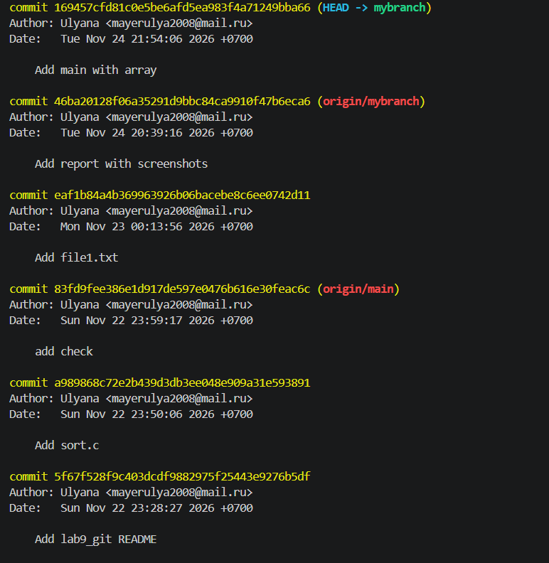

17.Добавим в sort.c в main() printf("hello git\n"):

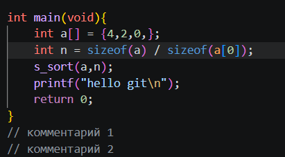

18.Посмотрим содержимое файла sort.c:

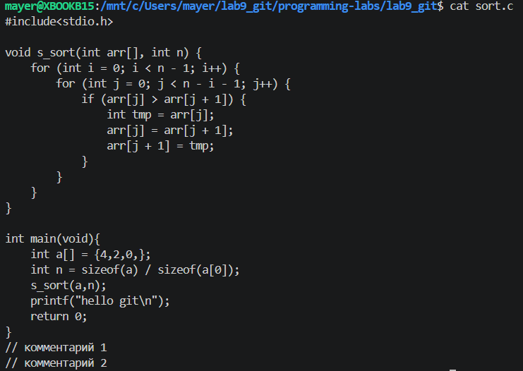

19.git status:

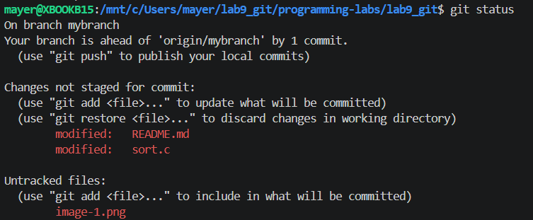

20.git restore sort.c:

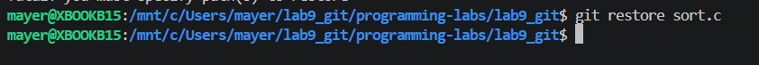

21.Содержимое sort.c:

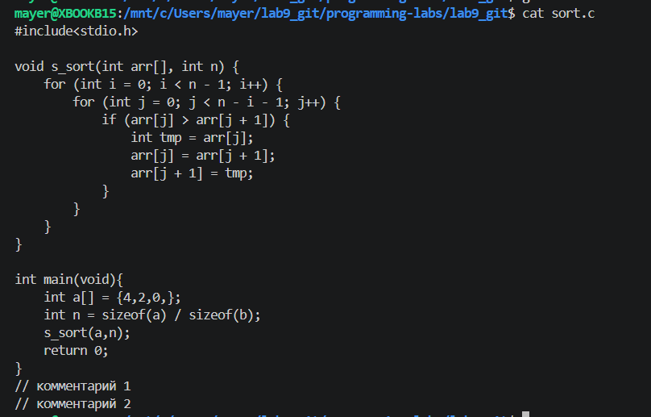

22.git status:

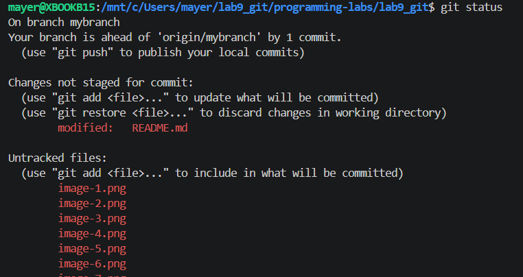
 
23.Запушим на удаленный репо ветку